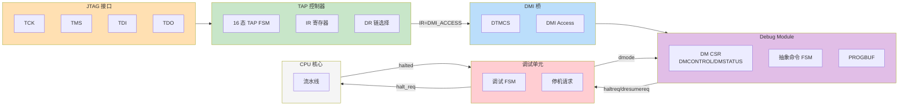
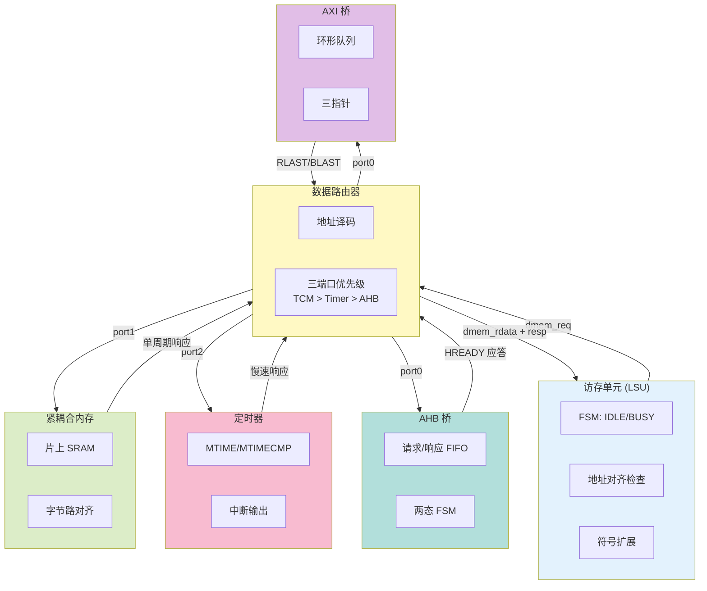
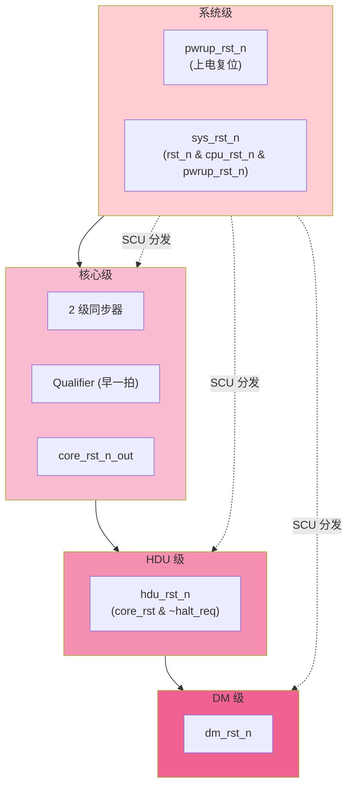
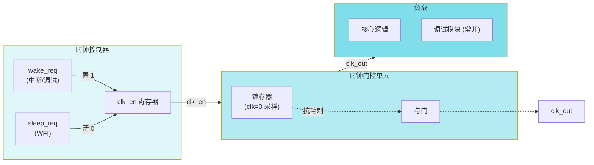
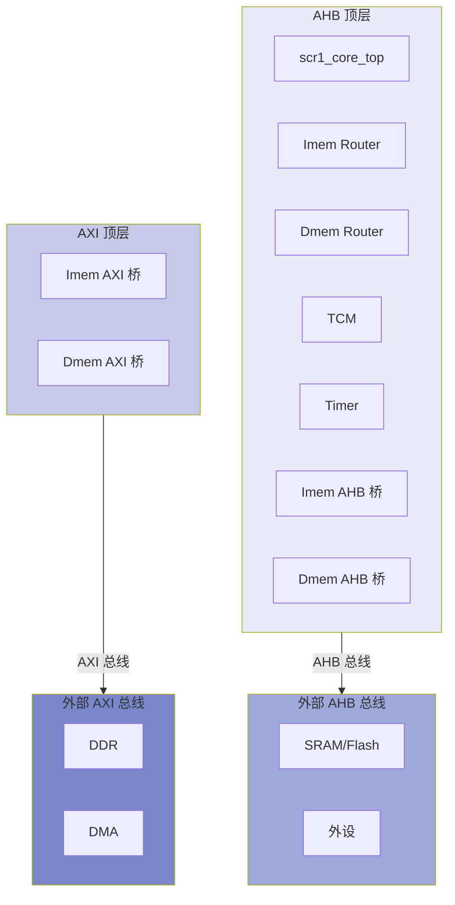

# SCR1 数据通路全景图

本文档用 Mermaid 绘制 SCR1 RISC-V 核心的完整数据通路，涵盖指令执行主通路、中断/异常 trap 流程、调试访问链路、存储层次。

---

## 1. 指令执行主通路（IFU → IDU → EXU → MPRF → CSR）

```mermaid
flowchart LR
    subgraph IFU ["取指单元 (IFU)"]
        ifu_q["指令队列<br/>(环形缓冲 4 半字)"]
        ifu_fsm["FSM: IDLE/FETCH"]
        ifu_pend["未完成事务计数器"]
    end
    
    subgraph IMEM ["指令存储器"]
        imem_tcm["TCM"]
        imem_ahb["AHB 桥"]
        imem_axi["AXI 桥"]
    end
    
    subgraph IDU ["译码单元 (IDU)"]
        idu_decode["指令译码<br/>(纯组合逻辑)"]
        idu_illegal["非法指令检测"]
    end
    
    subgraph EXU ["执行单元 (EXU)"]
        exu_queue["指令队列<br/>(级间寄存器)"]
        exu_ialu["IALU 双加法器"]
        exu_pc["PC 逻辑"]
        exu_wb["写回选择器"]
    end
    
    subgraph MPRF ["寄存器堆"]
        mpRF_rs["2 读端口"]
        mpRF_w["1 写端口"]
    end
    
    subgraph CSR ["控制状态寄存器"]
        csr_trap["Trap 逻辑"]
        csr_regs["MSTATUS/MIE/MIP..."]
        csr_counter["MCYCLE/MINSTRET"]
    end
    
    IFU -->|ifu2idu_instr| IDU
    IDU -->|idu2exu_cmd| EXU
    EXU -->|rs1/rs2 addr| MPRF
    MPRF -->|rs1/rs2 data| EXU
    EXU -->|rd addr/rd data/w_req| MPRF
    EXU -->|exc/irq/mret| CSR
    CSR -->|new_pc| IFU
    IFU -->|取指请求 | IMEM
    IMEM -->|指令数据| IFU
    
    style IFU fill:#e1f5ff
    style IDU fill:#fff4e1
    style EXU fill:#e8f5e9
    style MPRF fill:#fce4ec
    style CSR fill:#f3e5f5
```



**关键信号流**：
1. IFU 从 IMEM 取指 → 指令队列 → IDU
2. IDU 译码 → `idu2exu_cmd`（执行命令）→ EXU 队列
3. EXU 读 MPRF（rs1/rs2）→ IALU 运算 → 写回 MPRF（rd）
4. CSR 处理中断/异常 → 更新 PC → IFU 取新 PC

---

## 2. 中断/异常 Trap 流程

```mermaid
sequenceDiagram
    participant EXU
    participant CSR
    participant IPIC
    participant MPRF
    participant IMEM
    
    EXU->>CSR: take_exc (异常) 或 take_irq (中断)
    CSR->>CSR: 保存现场 (MEPC=MPC, MCAUSE=原因，MTVAL=附加信息)
    CSR->>CSR: 关中断 (MIE=0, MPIE=旧 MIE)
    CSR->>CSR: 计算新 PC (MTVEC.base + offset)
    CSR->>EXU: csr2exu_new_pc
    EXU->>IFU: new_pc_req + new_pc
    IFU->>IMEM: 从新 PC 取指
    IMEM->>IFU: handler 第一条指令
    IFU->>IDU->>EXU->>CSR: handler 执行
    EXU->>CSR: MRET 指令
    CSR->>CSR: 恢复现场 (MIE=MPIE)
    CSR->>EXU: new_pc = MEPC
    EXU->>IFU: 返回被中断的指令
```

**异常 vs 中断**：
| 特性 | 异常 | 中断 |
|---|---|---|
| 来源 | 指令自身（非法指令/访存错误） | 外部异步（IPIC/定时器/软件） |
| 优先级 | 高（`e_irq = take_irq & ~take_exc`） | 低 |
| MEPC | 出错指令地址 | 被中断的指令地址 |
| MCAUSE | 异常码（最高位=0） | 中断码（最高位=1） |

---

## 3. 调试访问链路（JTAG → TAPC → DMI → DM → HDU）



**调试会话流程**：
1. 调试器 → JTAG TMS/TDI → TAPC 移位 → IR 译码 → 选中 DMI 链
2. DMI 解析 op/address/data → DM 寄存器访问
3. DM 写 `DMCONTROL.haltreq=1` → HDU 发 `halt_req` → 流水线停机
4. 调试器通过 DM 读/写核寄存器（抽象命令或 PROGBUF）
5. 调试器写 `DMCONTROL.dresumereq=1` → 恢复执行

---

## 4. 存储访问层次（LSU → Router → TCM/Timer/AHB/AXI）



**地址译码示例**（TCM 在 `0x00480000`，Timer 在 `0x00490000`）：
```
addr[31:0] & PORT1_MASK == PORT1_PATTERN → TCM (32KB @ 0x480000)
addr[31:0] & PORT2_MASK == PORT2_PATTERN → Timer (4KB @ 0x490000)
其他 → AHB/AXI 桥（外部总线）
```

---

## 5. 复位层次（Sys ⊃ Core ⊃ HDU ⊃ DM）



**关键设计**：
- `reset_n_qlfy` 比 `reset_n_out` 早一拍拉低（给 RDC 同步器留时间）
- HDU 复位独立于核心（系统复位时调试器不能失联）
- DM 用 `scr1_reset_buf_cell` 缓冲（`:454-462`）

---

## 6. 时钟门控（ClkCtrl → ICG → 全芯片）



**ICG 抗毛刺原理**：
```systemverilog
always_latch begin
    if (~clk) latch_en <= clk_en;  // 只在 clk=0 时采样
end
assign clk_out = latch_en & clk;   // 高电平永远完整
```

---

## 7. 完整 SoC 视图（Top 层级）



---

## 附录：32 个模块索引

详见 [`docs/module-walkthroughs/README.md`](../module-walkthroughs/README.md)

---

*本文档配合 32 个模块讲解使用，提供全局视角。*
